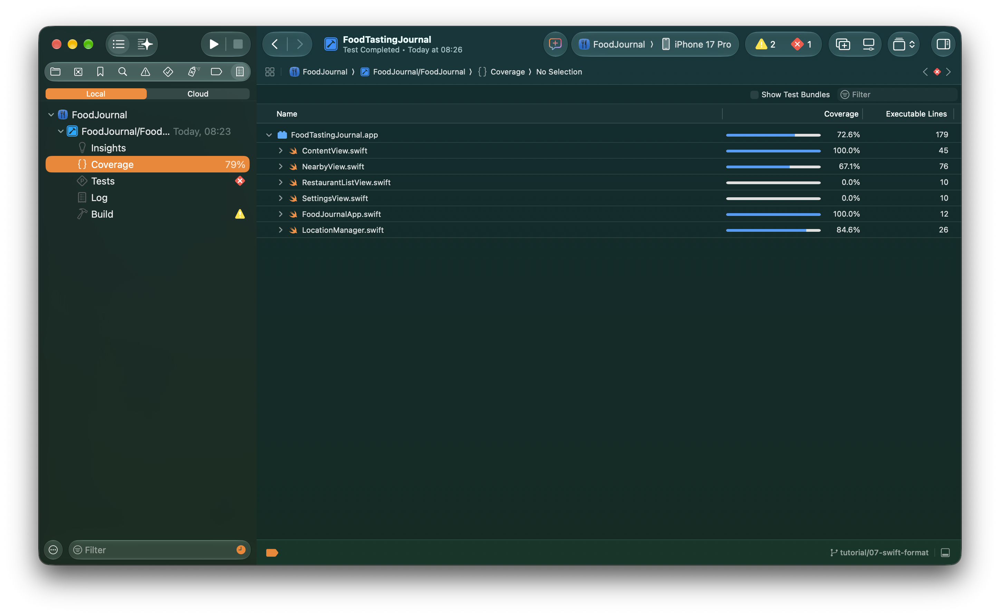
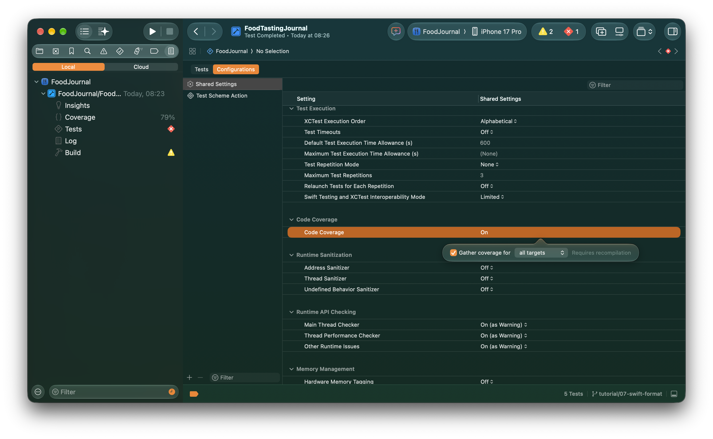

# Test Coverage in Xcode

Your tests pass and every diamond is green, but how much of your app did they actually exercise? __Test coverage is the percentage of your code that runs while your test suite runs__. Xcode measures it line by line, function by function and file by file. It doesn't judge whether your tests are good. It shows which code your tests reach and which code they never touch.

Why bother? Because untested code is where bugs hide. Coverage gives you:

* **Visibility:** you can see exactly which code paths have no tests at all.
* **Confidence to refactor:** well-covered code can be changed with far less fear of breaking something.
* **Smarter priorities:** you spend your testing effort on the gaps, not on code that's already covered.
* **A health signal over time:** a falling percentage tells you new code is going out without tests.

Xcode has coverage built in, yet most teams never switch it on. It works with both XCTest and Swift Testing, and turning it on takes about thirty seconds:

1. **Open your test plan** (Product → Test Plan → Edit Test Plan, or from the scheme editor), go to the **Configurations** tab, select **Shared Settings**, and turn on **Code Coverage**. You can gather it for all targets or only the ones you care about.
2. **No test plan?** Use Edit Scheme → Test → Options and tick **Code Coverage** instead.
3. **Run your tests (⌘U).** Coverage is recorded automatically into the `.xcresult` bundle.

Then open the **Report navigator** to see coverage broken down by target, file and function, or turn on the gutter annotations in the source editor to see the lines your tests never ran.

Coverage won't write good tests for you, but it clearly shows you where you haven't looked yet. Turn it on, take an honest look, and let it guide where your next test goes.

> "Program testing can be used to show the presence of bugs, but never to show their absence." — Edsger W. Dijkstra

Ace